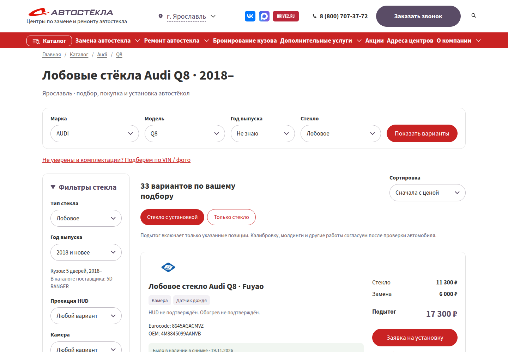

# Автостёкла — офлайн-копия

Скачайте репозиторий целиком и откройте `index.html` двойным щелчком. Сервер и установка зависимостей не нужны. Для каталога можно сразу открыть [`catalog/index.html`](catalog/index.html).

Сохранены девять страниц: главная, блог, две статьи, каталог, Audi, Audi Q8, поколение Q8 и карточка стекла AGC. Переходы между ними работают без интернета. Несохранённые страницы открываются на основном сайте и требуют интернета.

## Что внедрено в каталоге

- Компактный подбор по автомобилю, году и типу стекла; поиск марок и моделей на русском и латинице.
- Все 33 сохранённых лобовых стекла Audi Q8, исходные фильтры опций, стабильная сортировка и загрузка следующих карточек.
- Шесть исходных флажков опций. Неуказанная опция считается неподтверждённой; её отсутствие не подменяется отсутствием данных.
- Цена стекла, услуга замены и подытог; переключение между установкой и покупкой только стекла. Неизвестная цена не превращается в ноль.
- Исходные похожие товары от других производителей, преимущества, дополнительные услуги, отзывы и адреса центров на странице AGC.
- Полное исходное название и таблица характеристик товара. В исходном месте цены сохранён выбор стекла с установкой или без неё; на телефоне доступна нижняя панель цены.
- Подбор по VIN или фото, форма с выбранным товаром, способом покупки, стоимостью и центром. Проверяются телефон, VIN и формат/размер фото.
- Выбор одного из двух центров Ярославля, контакты и маршруты, гарантийные блоки, этапы установки и FAQ.
- Выбранные фильтры и сортировка сохраняются при переходах; предусмотрен пустой результат. Доступны управление с клавиатуры и закрытие диалогов по Escape.

[Карточка товара на телефоне](docs/product-mobile.png) · [форма заявки](docs/form-mobile.png).

Оформление сверено с текущими страницами autosteklo.pro: используются штатный контейнер `base-container`, размеры заголовков, шрифт Source Sans Pro, разметка хлебных крошек с разделителем «—», классы кнопок и карточек марок. Ширина контейнера на экране 1440 px — 1290 px; базовый H1 — 32 px, на телефоне — 24 px. Основной текст масштабируется по исходной формуле сайта. Для новых карточек использованы исходные рамки, скругления и цвета; блок подбора повторяет красную форму с фирменным фоном.

На главной странице каталога убраны подзаголовок про Ярославль, пояснение про 33 лобовых стекла Audi Q8 и счётчик марок. Добавлены оригинальная форма «Не нашли что искали? Оставьте заявку», адреса двух центров и мобильного сервиса, а также блок «Что вы найдете в нашем каталоге». Разметка этих блоков хранится в `tools/catalog_native_blocks.html.txt`.

В верхней форме каталога восстановлен исходный вид сайта: тип стекла, марка, модель, год выпуска, тип кузова и кнопка «Подобрать стекло». Заголовок «Подберите стекло для своего автомобиля в Ярославле» сохранён как `p`. Шаблон — `tools/catalog_native_picker.html.txt`; поля работают локально, поддерживают клавиатуру и переход к сохранённому поколению Audi Q8. Раздел марок озаглавлен «Выберите марку вашего автомобиля», приписки на плитках убраны, плитка Audi выделена светлым фоном.

На странице Audi убраны подзаголовок про Ярославль, пояснение об онлайн-переходах и счётчик моделей. Плитки моделей используют исходную разметку и стили сайта. Добавлены та же форма заявки, адреса центров и мобильного сервиса, три исходных текста с фотографиями. Текстовые блоки Audi хранятся в `tools/audi_native_content.html.txt`.

На Audi также восстановлена форма с пятью полями в исходном оформлении; заголовок «Подберите стекло для своего автомобиля» сохранён. Над моделями указан текст «Выберите марку вашего автомобиля». Сразу после моделей показаны 10 исходных карточек товаров из сохранённой страницы Audi: изображения, характеристики, цены, стоимость замены и кнопки открывают локальную форму с выбранным товаром. Шаблон — `tools/audi_native_products.html.txt`; эти товары не добавляются в список из 33 стёкол Q8.

Страница Audi Q8 повторяет исходный каталог: поиск, плитка поколения «5D RANGER (2018 - )», 10 исходных карточек товаров и форма с пятью полями под ними. Сразу после H1 расположен блок «Не знаете, какое стекло выбрать?». Блок «Где установить стекло» удалён; гарантии, отзывы, «Как проходит замена» и FAQ сохранены. Полные 33 стекла с фильтрами доступны на странице поколения. Шаблон карточек Q8 — `tools/q8_native_products.html.txt`.

Под основными блоками Audi Q8 добавлены исходная форма «Не нашли что искали? Оставьте заявку», адреса двух центров и мобильного сервиса Ярославля, три исходных текста об автостеклах Audi Q8 с фотографиями. Шаблон текста — `tools/q8_native_content.html.txt`; форма и адреса используют общий `tools/catalog_native_blocks.html.txt`. Разметка размещена вне контейнера доработок, чтобы сохранить штатные шрифты, ширину и оформление.

На странице поколения восстановлены исходный H1, логотип Audi, счётчик, фильтр с поколением, типами стекла и шестью флажками опций, ссылки сортировки и мобильная кнопка «Фильтр». Блок помощи расположен сразу после заголовка. Карточки используют исходные изображения, названия, характеристики, цены и кнопки; добавлен подытог с установкой. Подпись наличия — «В наличии» или «Под заказ». Повторный список опций, дата, блок «Параметры и совместимость», кнопка сравнения и пояснение над списком удалены. Панель сравнения на странице поколения не показывается, в том числе при сохранённом выборе с других страниц. Режим «Только стекло» пересчитывает сумму и состав заявки. Дополнительные параметры удалены; их старые сохранённые значения больше не применяют скрытые фильтры. Названия шести опций повторяют основной сайт; опция 8 — «Обогрев», опция 12 — «Пленочный обогрев». Шаблоны фильтра и сортировки — `tools/generation_native_filters.html.txt` и `tools/generation_native_sort.html.txt`; оформление и подключение к общим функциям — `assets/catalog-generation.css` и `assets/catalog-generation.js`. Все 33 товара и выбранные фильтры работают без сети.

На странице поколения убраны блок «Где установить стекло» и счётчик «Показано … из …». Кнопка «Показать еще» использует исходные классы и оформление. Добавлены штатная форма заявки и адреса центров и мобильного сервиса. После адресов размещены три исходных текста с фотографиями, затем плитки «Другие типы стекол на Audi Q8», «Другие модели Audi Q8» и «Стекла для других автомобилей». Шаблоны — `tools/generation_native_content.html.txt` и `tools/generation_native_links.html.txt`; несохранённые категории ведут на основной сайт.

Карточка AGC восстановлена по исходной странице: хлебные крошки, возврат в каталог, полное название и Eurocode, изображение, наличие, производитель и рейтинг, таблица характеристик, три похожих товара, преимущества, восемь дополнительных услуг, форма и пять сохранённых отзывов, адреса центров и исходный текст. Шаблон — `tools/product_native_page.html.txt`. В исходном месте цены сохранён новый блок «Стекло с установкой / Только стекло», расчёт и локальная заявка; блоки каталога и текст страницы находятся вне контейнера доработок и используют штатные стили. `assets/product-native.js` подключает кнопки похожих товаров к локальной форме и не отправляет отзывы или запросы на сервер. Карусель услуг, выбор услуги и оценка в форме отзыва используют исходный код сайта.

## Данные и ограничения

Каталог и цены зафиксированы **19.11.2026**. Для AGC, арт. 92644: стекло — 44 650 ₽, замена — 6 000 ₽, подытог — 50 650 ₽. Калибровка, молдинги и другие необходимые работы согласуются после проверки автомобиля. Наличие в снимке не подтверждает наличие в конкретном центре.

**Формы не отправляют данные, не бронируют время и не принимают оплату.** После проверки формы появляется явное сообщение об офлайн-режиме. Для реального обращения указаны телефон и ссылки на сайт. Введённые имя, телефон, VIN и фото остаются только в открытой вкладке; в хранилище сохраняются только неперсональные параметры подбора. События `catalog:interaction` локальные и не содержат персональных данных. Для рабочего сайта отдельно нужны серверный обработчик, актуальные остатки и интеграция аналитики.

На всех девяти страницах сохранён `noindex, nofollow`. Внешняя аналитика, чат и отслеживание звонков исключены. Карты и ссылки с отметкой «Онлайн» требуют интернета. Главная, блог и статьи сохраняют ранее согласованные доработки.

## Файлы и проверка

- `assets/catalog-experience.css` — оформление в палитре сайта и адаптивная вёрстка.
- `assets/catalog-experience.js` — подбор, фильтры, сравнение и локальные формы.
- `assets/catalog-experience-data.js` — нормализованные данные снимка. Исходные данные сохранены в `offline-catalog-data.js`.
- `tools/apply_catalog_experience.py` — повторное применение шаблонов к пяти сохранённым страницам; нужен Python и `beautifulsoup4`. Просмотр сайта не требует Python.
- `tests/catalog_smoke.py` — проверка сценариев через `file://` с заблокированными HTTP(S)-запросами. Нужны Python, `playwright` и Chromium. Запуск: `python tests/catalog_smoke.py`; для установленного отдельно браузера добавьте `--browser /path/to/chrome`.
- `tests/style_smoke.py` — сравнение добавленных блоков со штатным CSS сайта на ширинах 320, 390, 768, 1280, 1440 и 1920 px. Запуск: `python tests/style_smoke.py` с тем же необязательным параметром `--browser`.
- `product-native-verification.json` — сверка 16 исходных компонентов карточки на шести размерах экрана, переключения цены, заявок, услуг и отзывов.
- `catalog-generation-content-verification.json` — сверка исходного текста, фотографий, 22 ссылок на модели Audi, порядка блоков и оформления на четырёх размерах экрана.
- `catalog-generation-cards-verification.json` — проверка упрощённых карточек, наличия всех 33 товаров, скрытия сравнения, расчёта заявки и адаптивной вёрстки.
- `catalog-generation-blocks-verification.json` — проверка кнопки, формы и нижних блоков страницы поколения, переноса старых фильтров и общей регрессии.
- `catalog-experience-verification.json` — результаты проверки на ширинах 320, 390, 768 и 1440 px.
- `catalog-style-verification.json` — результаты 30 сравнений оформления со штатными стилями.

Проверено в Chromium на Linux. Проверка включает поиск, локальную навигацию, фильтры, расчёт, валидацию, восстановление состояния и 20 сочетаний страниц с шириной окна.
